<div align="center">

# Asset Game MMORPG 2D

**A complete marketplace for HD pixel-art 2D game assets in an Eastern-fantasy style**
(Xianxia · Wuxia · Xuanhuan · Eastern mythology · Dark fantasy · MMORPG/RPG 2D)

**English** · [Tiếng Việt](README.vi.md)

</div>

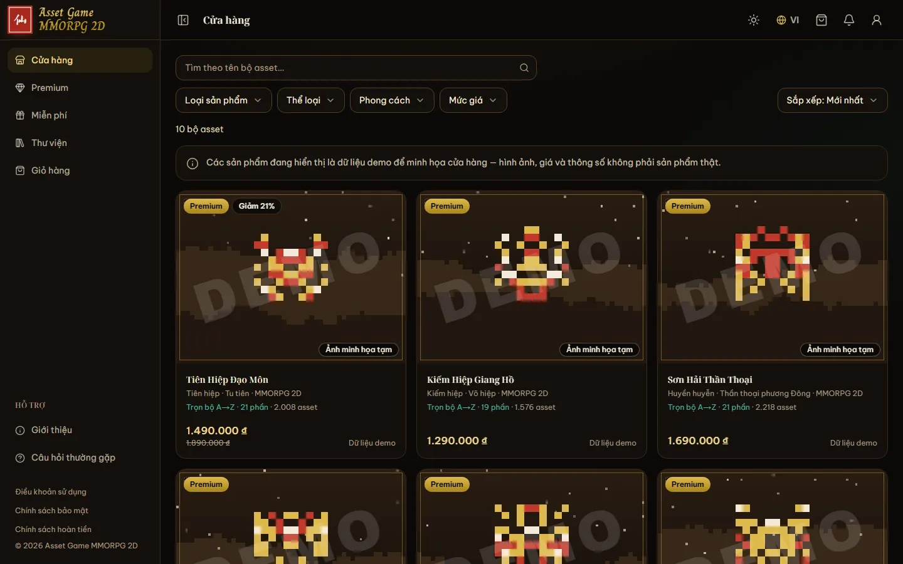

This is a full e-commerce platform, not a landing page. Buyers search and preview asset packs, pay for them, then download them again from a personal library. The shop owner runs everything from an Admin area. The whole interface is available in **Vietnamese, English and Chinese**.

The repository ships as a **ready-to-run demo**. Every value in `.env.example` is a safe default, and `npm run db:seed` fills the shop with 10 demo packs, 21 categories and demo coupons. You can run the whole project on your own computer **without any cloud account**, then add real services (Neon, Cloudflare R2, Vercel, SePay, Resend, Google sign-in) when you need them.

> All demo content (pictures, prices, specs) is clearly marked **DEMO** on screen and is not a real product.

## Contents

1. [Screenshots](#screenshots)
2. [Features](#features)
3. [What makes it special](#what-makes-it-special)
4. [Tech stack](#tech-stack)
5. [Quick start (local, no cloud account)](#quick-start-local-no-cloud-account)
6. [Using the app](#using-the-app)
7. [Configuration](#configuration)
8. [Optional services and going live](#optional-services-and-going-live)
9. [Commands](#commands)
10. [Testing](#testing)
11. [Project structure](#project-structure)
12. [Troubleshooting](#troubleshooting)
13. [Documentation and license](#documentation-and-license)

## Screenshots

### Storefront

| Pack page                                     | Phone                                                   |
| --------------------------------------------- | ------------------------------------------------------- |
| 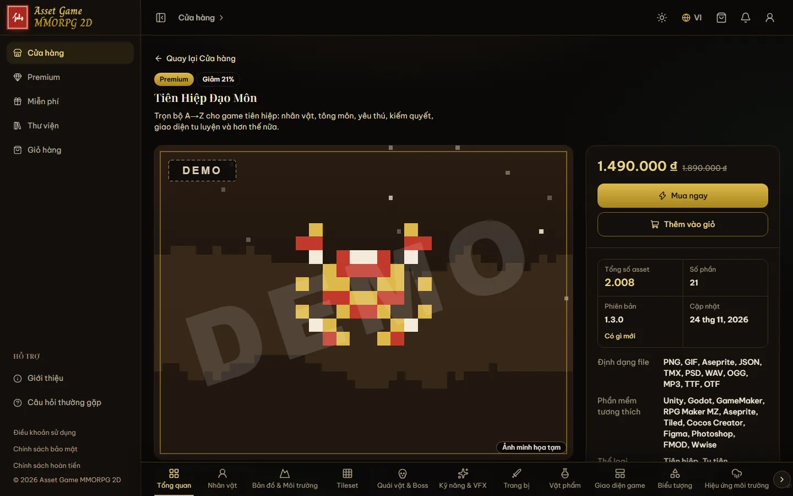 | 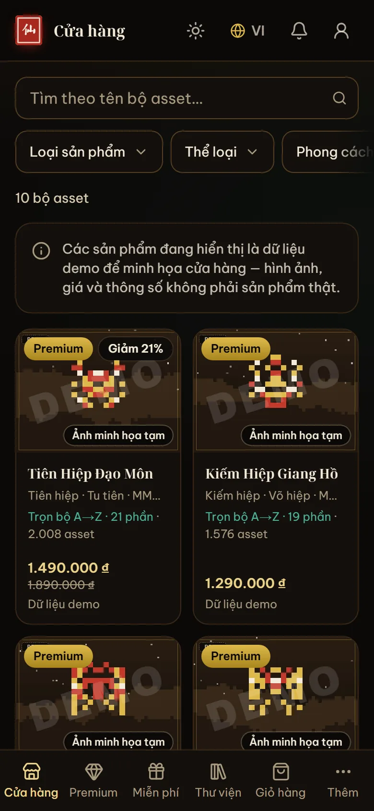 |

| Light theme                                        | Phone: pack page                                                |
| -------------------------------------------------- | --------------------------------------------------------------- |
| 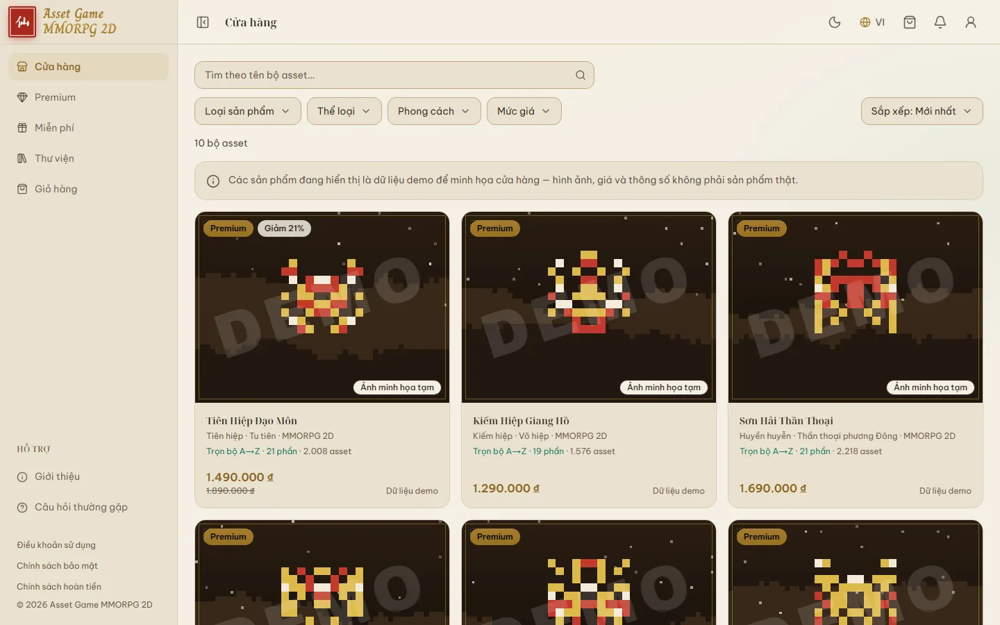 | 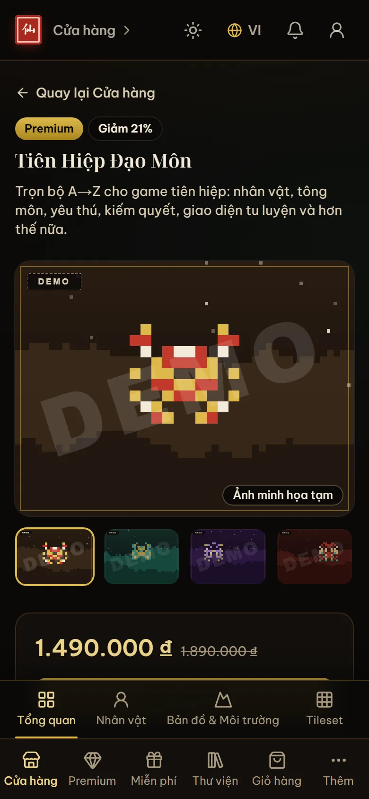 |

### Three languages

| English                                     | 中文                                        |
| ------------------------------------------- | ------------------------------------------- |
| 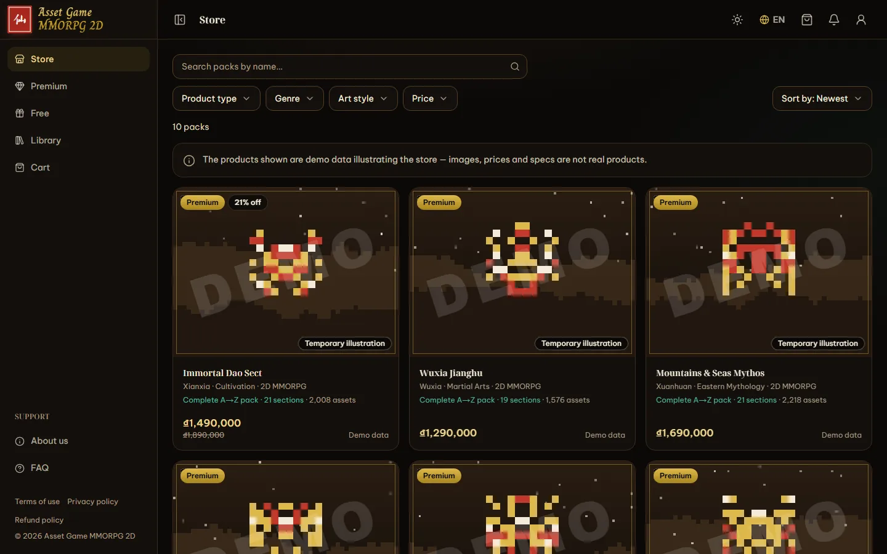 | 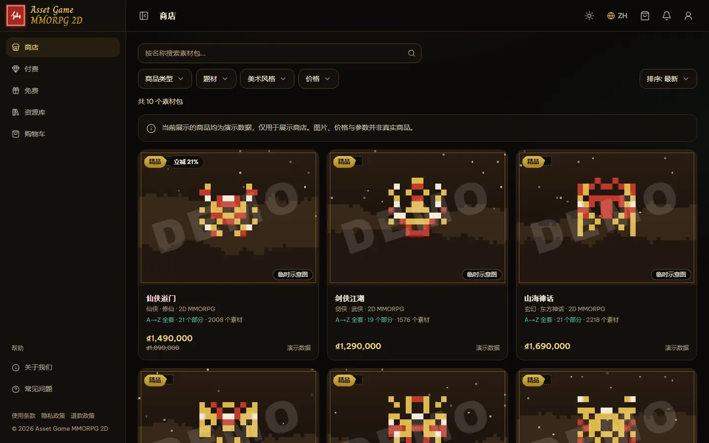 |

### Buying

| Cart with a coupon                    | Checkout                                      |
| ------------------------------------- | --------------------------------------------- |
| 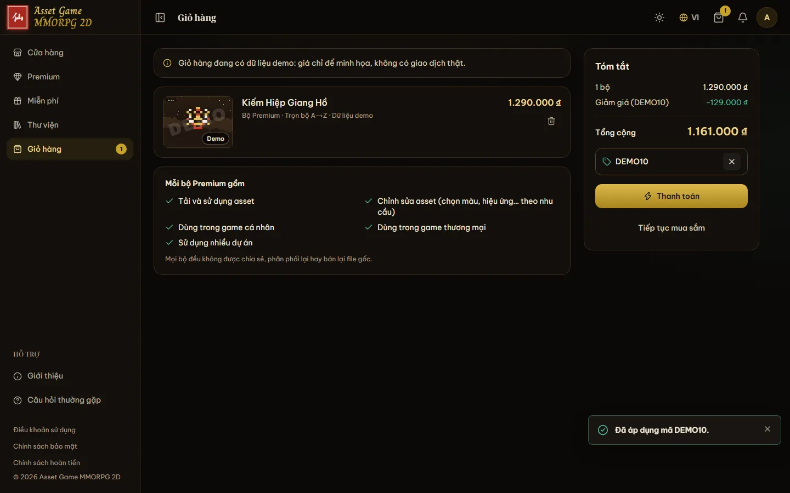 | 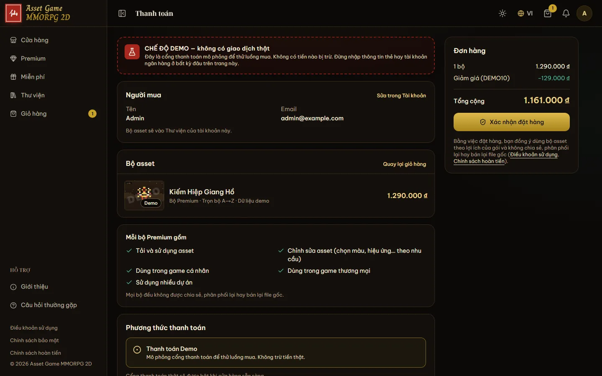 |

| Demo payment gateway                                  | Paid order                                        |
| ----------------------------------------------------- | ------------------------------------------------- |
| 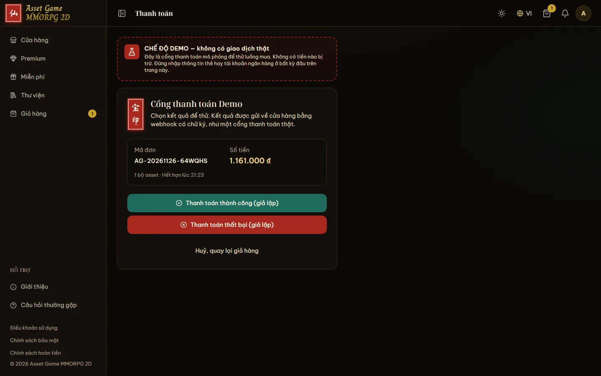 | 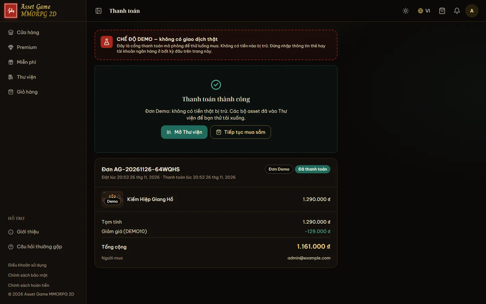 |

| Personal library                            |
| ------------------------------------------- |
| 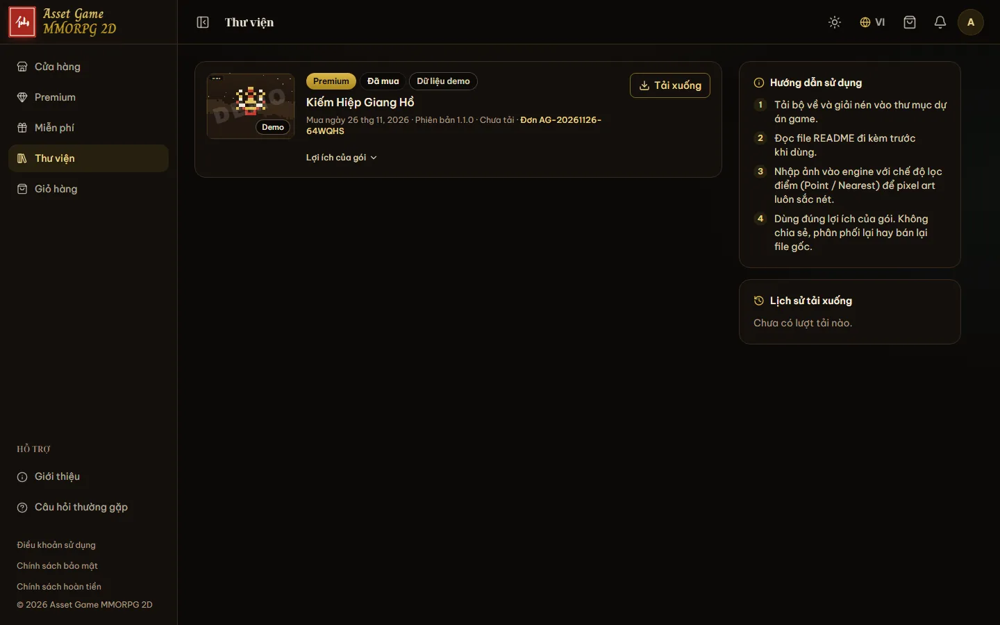 |

### Admin

| Overview and revenue chart                                | Pack editor                                                |
| --------------------------------------------------------- | ---------------------------------------------------------- |
| 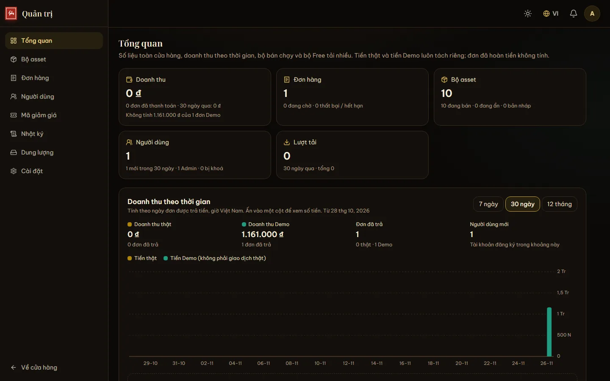 | 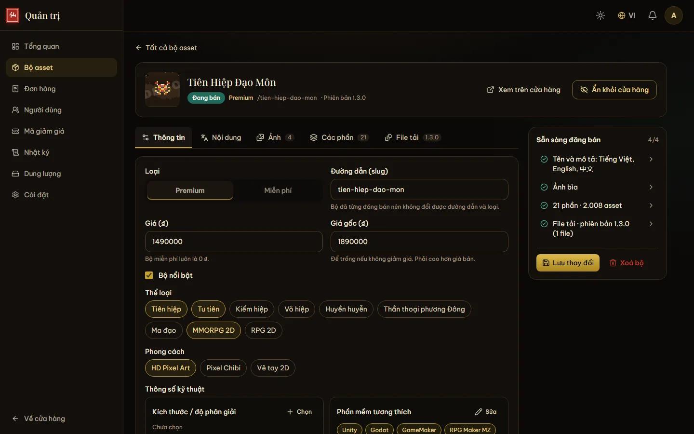 |

| Orders and finance                                    | Settings                                                  |
| ----------------------------------------------------- | --------------------------------------------------------- |
| 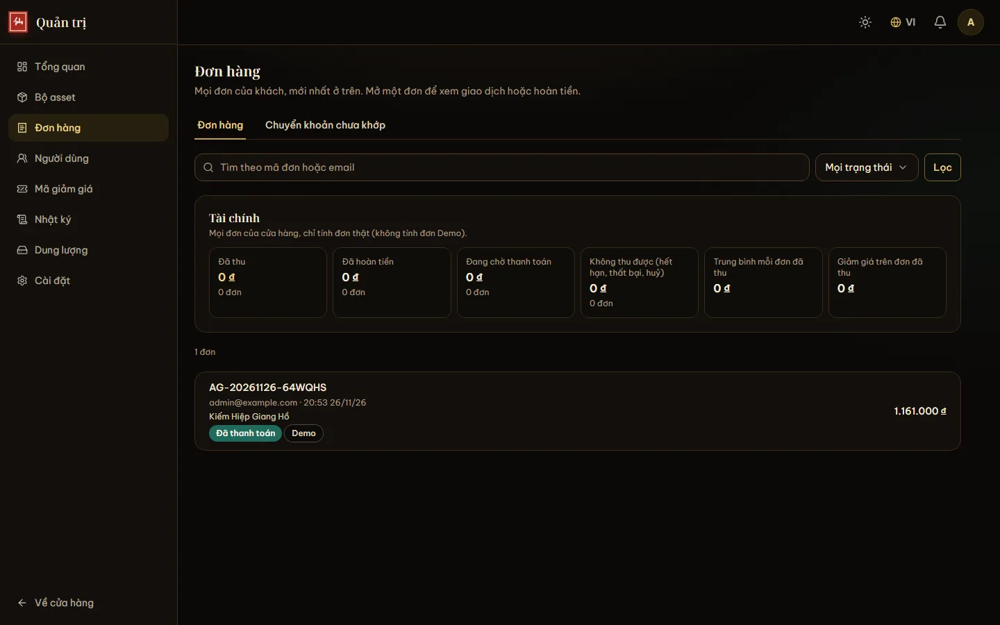 | 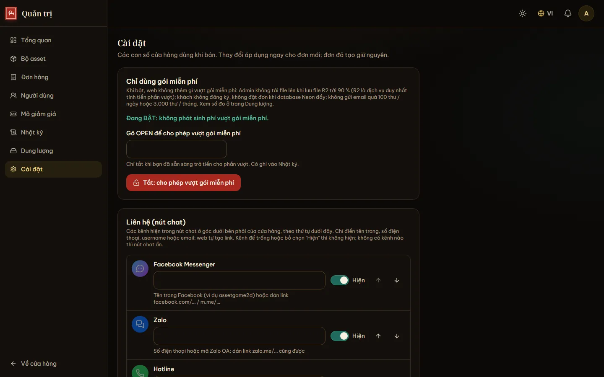 |

## Features

### Storefront

- **Shop:** search by name (with or without Vietnamese accents), filter by type (Free / Premium), genre, art style and price range, and sort by newest, best-selling or price. Results are paginated.
- **Pack page:** gallery with a full-screen viewer, image or video previews, total asset count, sections (characters, maps, tilesets, monsters, skills and so on), file formats, compatible software, version, and a "What's new" note for each version. A bar at the bottom jumps to each section.
- **Benefits per pack:** each pack lists what the buyer may do with it, Free and Premium separately, instead of generic license names.
- **Free packs:** shown as FREE. Signing in is required to download. Each account gets 2 downloads per Free pack and can buy more (the price is set in Admin).
- **Premium packs:** "Buy now" or "Add to cart". After payment the pack is in the library with unlimited downloads.
- **Contact chat button:** Messenger, Zalo, hotline, Telegram and email, entered by the Admin. Each channel can be turned on or off. When no channel is filled in, the button is hidden.
- **Info pages:** About, FAQ, Terms of use, Privacy policy, Refund policy (template content to edit before selling).

### Buying and payment

- **Cart** for guests and signed-in users (a guest cart merges into the account on sign-in), with **coupons** (percent or fixed amount, minimum order, dates, use limit).
- **Checkout:** prices and totals are always recomputed on the server. One unpaid order per account at a time; the buyer can pay it or cancel it.
- **Payment gateways**, chosen with `PAYMENT_PROVIDER`:
  - `demo` (default): a simulated gateway with a "Demo mode" banner. No money moves. It is refused in production.
  - `sepay`: VietQR bank transfer. The order is matched by a signed SePay webhook.
  - `momo`: MoMo wallet (built and tested on MoMo's test environment, currently paused).
- **Orders page** with each order's status, and an **order result page** after payment.

### Library and downloads

- **My library:** owned packs, purchase date, version, a "New version" badge with its notes, the pack's benefits, usage tips and download history.
- **Downloads:** the server checks ownership, then gives a link that expires after 60 seconds. Sold files are never in a public folder or public bucket.
- **Statistics page** for buyers: packs owned, downloads and money spent on their own account.

### Accounts

- Register, sign in, sign out, forgot password (email link), change password, profile.
- **Continue with Google** (optional; shown only when its keys are set). An existing account with the same email is linked, and a Google account can add a password later.
- Changing the password or being locked out signs out every other device at once.

### Admin area (`/admin`)

- **Overview:** revenue, orders, packs, users and downloads, plus a revenue chart (7 days, 30 days, 12 months). Real money and Demo money are always shown separately.
- **Asset packs:** a tabbed editor (info, text in 3 languages, images, sections, download files). It includes a "Ready to publish" checklist, uploads sent straight to storage, versions with "What's new" notes, featured packs, and hide or show.
- **Orders:** search, status filter and finance summary. Also refunds, which remove the pack and its extra downloads; **unmatched bank transfers** to resolve by hand; and manual orders.
- **Users:** details, purchase history, lock or unlock, gift a pack.
- **Coupons**, **Audit log** (every Admin action), **Usage** (how much of the free plans of Neon, R2 and Resend is used).
- **Settings:**
  - **Free plans only** mode (on by default): blocks uploads, sign-ups, orders or emails before a free plan would be exceeded. Turning it off requires typing `OPEN`.
  - Contact channels for the chat button.
  - Price of extra Free downloads.

### Languages, design, quality

- **Vietnamese (default), English, Chinese** across 100% of the interface, including toasts, errors, empty states, emails and Admin. Each pack is written per language; a pack not yet written in a language is hidden in that language.
- **Eastern-fantasy look:** gold, ink black, cinnabar red and jade, with red seals and ornaments. Calligraphy and display fonts support every Vietnamese diacritic. Dark theme by default, with a light theme switch.
- **Responsive dashboard layout:** a side menu on desktop, a bottom tab bar on phones.
- **SEO:** sitemap, `hreflang` alternates, share cards, `noindex` on private pages.

## What makes it special

- **Sold files cannot leak.** They live in a private bucket (or in `.storage/` outside `public/` locally). Every download checks ownership on the server and uses a short-lived signed link. No Premium file URL is ever rendered into HTML or stored.
- **Only a verified payment grants ownership.** A pack becomes owned only when a webhook with a valid signature confirms the payment. Replayed or tampered webhooks and wrong amounts are refused.
- **The Demo gateway can never take real orders.** The app refuses to start in production with `PAYMENT_PROVIDER=demo`.
- **Sessions are checked against the database on every request.** The JWT carries a `sessionVersion` that is compared with the user's current value, so a locked account or a changed password logs out old sessions immediately.
- **Safety guards on the database.** `npm run db:*` refuses any host listed as production. Production migrations go through a separate command that asks you to type the database endpoint first.
- **Built to stay free.** The "Free plans only" mode and the Usage page keep the shop within the free plans of Neon, R2 and Resend.
- **Rate limits:** failed sign-ins, coupon guesses, sign-ups, password resets and downloads (100 per hour per account).
- **Configuration is validated at startup.** A missing or unsafe value (Demo in production, a short secret, an `r2.dev` address in production…) stops the app with a clear message.
- **Tested end to end:** unit tests, integration tests on a real database, and Playwright tests on desktop and phone for every main flow.

## Tech stack

| Area           | Technology                                                                                              |
| -------------- | ------------------------------------------------------------------------------------------------------- |
| App            | **Next.js 16.4** (App Router, Cache Components, Turbopack), **React 19**, TypeScript                    |
| Styling and UI | Tailwind CSS 4, Radix UI, lucide icons; fonts: Be Vietnam Pro, Noto Serif Display, Charm, Ma Shan Zheng |
| Database       | **PostgreSQL** with **Prisma 7** (`@prisma/adapter-pg`); Neon in the cloud, Docker locally              |
| Auth           | **Auth.js v5** (email + password with argon2id, optional Google)                                        |
| Languages      | **next-intl** (`vi`, `en`, `zh`)                                                                        |
| Validation     | Zod 4                                                                                                   |
| File storage   | Local folder in development, **Cloudflare R2** (S3 API) in production                                   |
| Payments       | Demo, SePay (VietQR), MoMo                                                                              |
| Email          | Files in `.mail-outbox/` in development, **Resend** in production                                       |
| Hosting        | **Vercel** (scheduled jobs in `vercel.json`)                                                            |
| Tests          | Vitest (unit, integration), Playwright (E2E, desktop + phone)                                           |

## Quick start (local, no cloud account)

### Requirements

- **Node.js 20.9 or newer** and npm
- **Docker Desktop** (for PostgreSQL), or any PostgreSQL you already have
- Git

### Steps

Run every command from the **repository root**.

```bash
# 1. Get the code and install (also generates the Prisma client)
git clone <your repository URL> asset-game
cd asset-game
npm install

# 2. Start PostgreSQL in Docker (choose your own password)
docker run -d --name asset2d-postgres --restart unless-stopped \
  -e POSTGRES_USER=asset2d -e POSTGRES_PASSWORD=<choose-a-password> -e POSTGRES_DB=asset2d \
  -p 127.0.0.1:5432:5432 -v asset2d-pgdata:/var/lib/postgresql/data postgres:17

# 3. Create your local settings file
cp .env.example .env.local
```

Open `.env.local` and fill in these lines. Leave everything else as it is.

```dotenv
DATABASE_URL=postgresql://asset2d:<your-password>@localhost:5432/asset2d
DIRECT_URL=postgresql://asset2d:<your-password>@localhost:5432/asset2d
AUTH_SECRET=<output of: npx auth secret>
CRON_SECRET=<any random string of 32+ characters (optional locally)>
```

```bash
# 4. Create the tables, then load the demo data
npm run db:migrate
npm run db:seed

# 5. Start the site
npm run dev
```

Open **http://localhost:3000**. It redirects to `/vi`; switch languages from the globe icon.

Locally, payments use the **Demo** gateway, files are stored in `.storage/`, and emails are written to `.mail-outbox/` instead of being sent. The only warning you may see is that `DATABASE_URL` is not a pooled connection; that is expected with a local database.

> On Windows PowerShell, write the `docker run` command on one line (remove the `\`).

### Become Admin

1. Create an account on the site (`/vi/register`).
2. Grant it the Admin role:
   ```bash
   npm run admin:grant -- you@example.com
   ```
3. Reload the page. **Admin** now appears in the avatar menu (`/vi/admin`).

To remove the role: `npm run admin:revoke -- you@example.com` (this also signs that account out everywhere).

## Using the app

### As a buyer

1. Browse **Shop**, filter or search, then open a pack.
2. **Free pack:** sign in, then click **Download for free**.
3. **Premium pack:** click **Buy now** (or **Add to cart**).
4. In the cart, try a demo coupon, then **Checkout** → **Place order**.
5. On the Demo gateway, choose **Simulate a successful payment** or **Simulate a failed payment**.
6. After success, open **Library** and download the pack (the demo download is a README file).

Demo coupons:

| Code          | Effect                                |
| ------------- | ------------------------------------- |
| `DEMO10`      | 10 % off, no minimum                  |
| `DEMO200K`    | 200,000 ₫ off orders from 1,000,000 ₫ |
| `DEMOHETHAN`  | Expired (to see the error)            |
| `DEMOHETLUOT` | Used up (to see the error)            |

### As the shop owner

- **Admin → Asset packs → New pack:** fill in the info, the text in each language, images, sections and the download file, then publish once the checklist is complete.
- **Admin → Settings:** add your contact channels (the chat button appears) and set the price of extra Free downloads.
- **Admin → Orders:** follow payments, refund, or create an order by hand.
- Browse the data directly: `npm run db:studio` (Prisma Studio).

## Configuration

All variables are listed and explained in [`.env.example`](.env.example). Real values go **only** in `.env.local` on your machine. That file is git-ignored; never commit it and never paste its values anywhere.

| Variable                                     | Purpose                                     | Local default                          |
| -------------------------------------------- | ------------------------------------------- | -------------------------------------- |
| `APP_ENV`, `APP_URL`                         | Environment and site address                | `development`, `http://localhost:3000` |
| `DATABASE_URL`                               | Connection used by the app (pooled on Neon) | your local PostgreSQL                  |
| `DIRECT_URL`                                 | Direct connection, used only for migrations | same as above locally                  |
| `PRODUCTION_DATABASE_HOSTS`                  | Production hosts that `db:*` must refuse    | empty                                  |
| `AUTH_SECRET`                                | Signs sessions (32+ characters)             | required                               |
| `AUTH_GOOGLE_ID`, `AUTH_GOOGLE_SECRET`       | Google sign-in (both or neither)            | empty = button hidden                  |
| `PAYMENT_PROVIDER`                           | `demo`, `sepay` or `momo`                   | `demo`                                 |
| `SEPAY_*`, `MOMO_*`                          | Gateway settings                            | empty                                  |
| `STORAGE_DRIVER`                             | `local` or `r2`                             | `local` (`.storage/`)                  |
| `R2_*`                                       | Cloudflare R2 buckets and token             | empty                                  |
| `MAIL_DRIVER`, `MAIL_FROM`, `RESEND_API_KEY` | `outbox` (files) or `resend`                | `outbox` (`.mail-outbox/`)             |
| `CRON_SECRET`                                | Protects `/api/cron/*` (32+ characters)     | optional locally                       |

The app checks these values at startup and refuses to run with an unsafe combination.

## Optional services and going live

Each service is optional locally and has a step-by-step guide in [docs/OPERATIONS.md](docs/OPERATIONS.md):

| Service           | Used for                                                                                     | Guide              |
| ----------------- | -------------------------------------------------------------------------------------------- | ------------------ |
| **Neon**          | Cloud PostgreSQL (pooled + direct connections, separate dev / preview / production branches) | §2                 |
| **Cloudflare R2** | Two buckets: public previews, private files; checked by `npm run storage:check`              | §7                 |
| **Vercel**        | Preview deployment (Demo gateway) and production                                             | §8, §9             |
| **SePay**         | Bank transfers (VietQR) with a signed webhook                                                | `.env.example`, §4 |
| **Resend**        | Real emails (password reset); `npm run mail:test -- <email>` sends a sample                  | §9                 |
| **Google Cloud**  | "Continue with Google"                                                                       | §10                |

Going live, in short:

1. Create the production database branch and the buckets. Then run `npm run prod:init`, fill in `.env.vercel-production` and check it with `npm run prod:check`. It lists every missing or unsafe value.
2. Apply migrations to production **yourself** with `npm run db:prod:migrate`, after a confirmation prompt. Never use `db:migrate` or `db:seed` on production.
3. Production needs a real gateway (`sepay` in `live` mode), R2 with a custom domain for images, Resend with a verified domain, and a `CRON_SECRET`.

## Commands

Run from the repository root.

| Group      | Command                                                                 | What it does                                                      |
| ---------- | ----------------------------------------------------------------------- | ----------------------------------------------------------------- |
| Run        | `npm run dev`                                                           | Development server at http://localhost:3000                       |
|            | `npm run build` / `npm start`                                           | Production build / run it                                         |
| Checks     | `npm run lint` · `npm run typecheck` · `npm run i18n:check`             | ESLint · TypeScript · same keys in all 3 languages                |
|            | `npm run format`                                                        | Prettier                                                          |
| Database   | `npm run db:migrate`                                                    | Apply / create migrations (dev only)                              |
|            | `npm run db:seed` / `db:seed:coupons`                                   | Demo data / demo coupons only                                     |
|            | `npm run db:generate` · `npm run db:studio`                             | Prisma client · Prisma Studio                                     |
| Admin      | `npm run admin:grant -- <email>` / `admin:revoke`                       | Give / remove the Admin role                                      |
| Jobs       | `npm run cron:run` (`-- reconcile` / `-- cleanup`)                      | Expire unpaid orders, clean old carts, files and counters         |
| Email      | `npm run mail:preview` · `npm run mail:test -- <email>`                 | Write sample emails to files · send one via Resend                |
| Storage    | `npm run storage:check` · `npm run storage:push`                        | Test R2 end to end · copy `.storage/` to R2                       |
| Preview    | `npm run preview:init` / `setup` / `check` / `grant` / `revoke`         | Vercel preview environment                                        |
| Production | `npm run prod:init` / `prod:check`                                      | Prepare and check production settings                             |
|            | `npm run db:prod:status` / `migrate` / `reference` / `grant` / `revoke` | Production database, **run by the owner only**, with confirmation |
| Icons      | `npm run icons`                                                         | Regenerate the favicons from the logo                             |

## Testing

```bash
npm test                          # unit tests (backend + frontend)
npm run test:integration          # integration tests on the development database
npm run build && npm run test:e2e # Playwright, desktop + phone (needs a build first)
```

- On Windows, run Vitest from **PowerShell** (from Git Bash it fails with "failed to find the runner").
- E2E runs on port 3100 and starts its own server. Stop anything else using that port first.
- Integration and E2E tests create tagged test data in the development database and remove it afterwards. Never point them at production.

## Project structure

One Next.js app split into three folders. Every `npm run …` command runs from the root.

```text
frontend/   Next.js app: pages and API routes (src/app), components, styles, fonts,
            translations (messages/vi.json, en.json, zh.json), E2E tests
backend/    Server code: modules (repository → service → actions), auth, payments,
            storage, mail, env validation; Prisma schema, migrations, seed; scripts; tests
docs/       Product, architecture, design, roadmap, decisions, operations
```

- Pages call **services** only. Services hold the business rules, repositories hold the Prisma queries, and actions or routes check auth and input.
- Interface text comes only from `frontend/messages/*.json`, never hard-coded.

## Troubleshooting

| Problem                                                        | Fix                                                                                                                                        |
| -------------------------------------------------------------- | ------------------------------------------------------------------------------------------------------------------------------------------ |
| The app stops with "unsafe environment configuration"          | Read the listed variables and fix them in `.env.local`. This check is on purpose.                                                          |
| `db:seed` fails with "Invalid URL"                             | A URL variable is present but empty (for example `MOMO_ENDPOINT=`). Restore the value from `.env.example`.                                 |
| Console shows `JWTSessionError: no matching decryption secret` | The browser keeps a session cookie signed with an old `AUTH_SECRET`. Delete the `authjs.*` cookies for localhost, or use a private window. |
| Cannot connect to the database                                 | Docker Desktop must be running; check `docker ps` shows `asset2d-postgres`.                                                                |
| No "Continue with Google" button                               | Expected until `AUTH_GOOGLE_ID` and `AUTH_GOOGLE_SECRET` are both set (redirect URI `http://localhost:3000/api/auth/callback/google`).     |
| No chat button                                                 | Add at least one contact channel in Admin → Settings.                                                                                      |
| "Admin" missing after `admin:grant`                            | Reload the page and check the email matches the registered account.                                                                        |
| Prisma client missing                                          | `npm run db:generate` (or `npm install`).                                                                                                  |
| Port 3000 busy                                                 | Another server is running: stop it or change the port.                                                                                     |

## Documentation and license

- [docs/README.md](docs/README.md): documentation index.
- [docs/PRODUCT.md](docs/PRODUCT.md): business rules, categories, demo data. [docs/ARCHITECTURE.md](docs/ARCHITECTURE.md): system design. [docs/DESIGN.md](docs/DESIGN.md): visual design.
- [docs/OPERATIONS.md](docs/OPERATIONS.md): environments and services. [docs/DECISIONS.md](docs/DECISIONS.md): confirmed decisions.
- [CLAUDE.md](CLAUDE.md): working rules for Claude Code on this repository.

Some docs are written in Vietnamese.

No open-source license has been chosen for this repository yet, so all rights are reserved by its owner. The bundled fonts (Ma Shan Zheng, Noto Serif Display) are under the SIL Open Font License 1.1; see [frontend/src/fonts/README.md](frontend/src/fonts/README.md).
