<div align="center">

# Asset Game MMORPG 2D

**Chợ tài nguyên đồ họa game 2D HD Pixel Art phong cách phương Đông, đầy đủ chức năng**
(Tiên hiệp · Võ hiệp · Huyền huyễn · Thần thoại phương Đông · Dark fantasy · MMORPG/RPG 2D)

[English](README.md) · **Tiếng Việt**

</div>

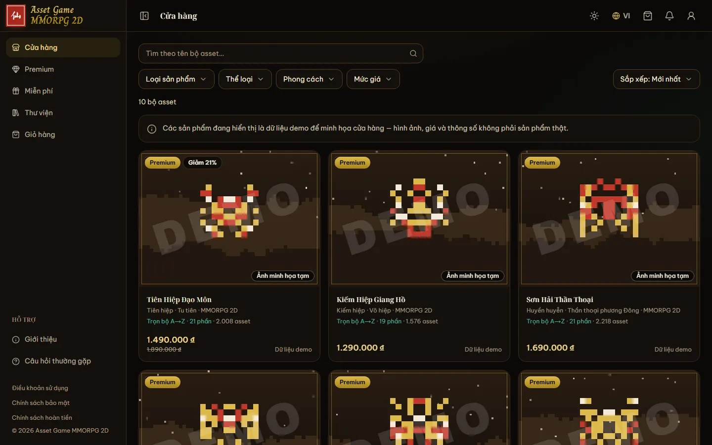

Đây là một nền tảng thương mại điện tử hoàn chỉnh, không phải trang giới thiệu. Người mua tìm kiếm, xem trước, thanh toán các bộ asset, rồi tải lại bất cứ lúc nào từ thư viện cá nhân. Chủ cửa hàng quản lý mọi thứ trong khu Quản trị (Admin). Toàn bộ giao diện có **tiếng Việt, tiếng Anh và tiếng Trung**.

Repo được để ở dạng **demo chạy được ngay**. Mọi giá trị trong `.env.example` là mặc định an toàn. Lệnh `npm run db:seed` nạp sẵn 10 bộ asset demo, 21 danh mục và các mã giảm giá demo. Bạn có thể chạy toàn bộ project trên máy **mà không cần tài khoản cloud nào**, rồi gắn dịch vụ thật (Neon, Cloudflare R2, Vercel, SePay, Resend, đăng nhập Google) khi cần.

> Mọi nội dung demo (ảnh, giá, thông số) đều ghi rõ **DEMO** trên giao diện, không phải sản phẩm thật.

## Mục lục

1. [Hình ảnh](#hình-ảnh)
2. [Chức năng](#chức-năng)
3. [Điểm đặc biệt](#điểm-đặc-biệt)
4. [Công nghệ](#công-nghệ)
5. [Cài đặt nhanh (trên máy, không cần cloud)](#cài-đặt-nhanh-trên-máy-không-cần-cloud)
6. [Cách sử dụng](#cách-sử-dụng)
7. [Cấu hình](#cấu-hình)
8. [Dịch vụ tuỳ chọn và chạy thật](#dịch-vụ-tuỳ-chọn-và-chạy-thật)
9. [Các lệnh](#các-lệnh)
10. [Kiểm thử](#kiểm-thử)
11. [Cấu trúc thư mục](#cấu-trúc-thư-mục)
12. [Lỗi thường gặp](#lỗi-thường-gặp)
13. [Tài liệu và giấy phép](#tài-liệu-và-giấy-phép)

## Hình ảnh

### Cửa hàng

| Trang bộ asset                                     | Điện thoại                                                       |
| -------------------------------------------------- | ---------------------------------------------------------------- |
| 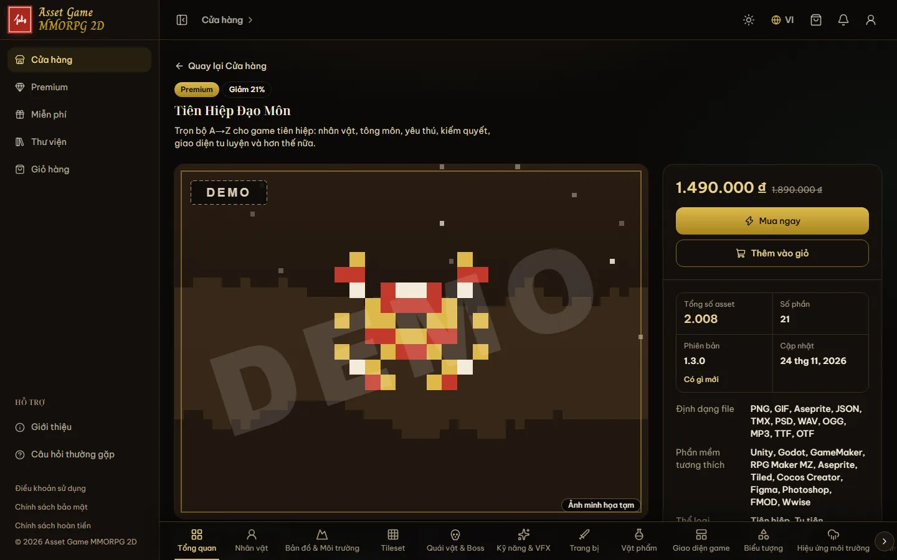 | 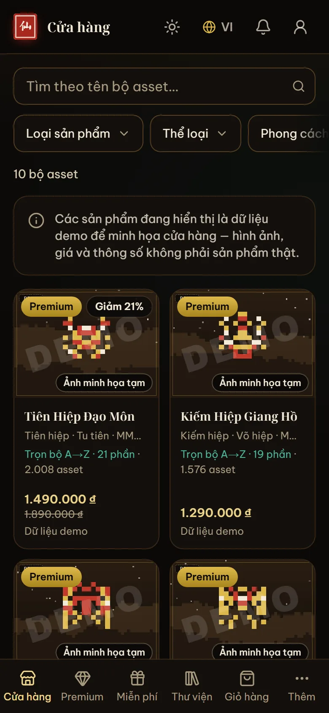 |

| Giao diện sáng                                        | Điện thoại: trang bộ asset                                                |
| ----------------------------------------------------- | ------------------------------------------------------------------------- |
| 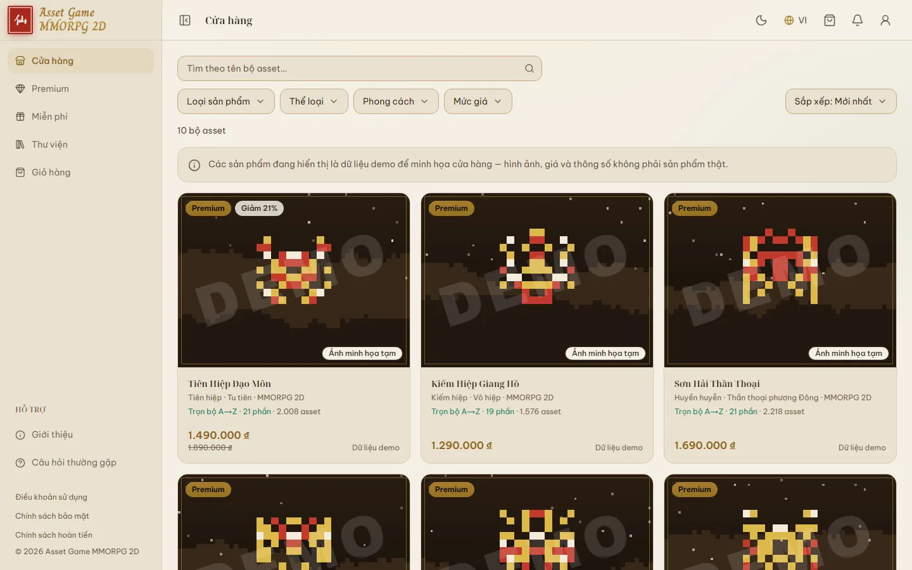 | 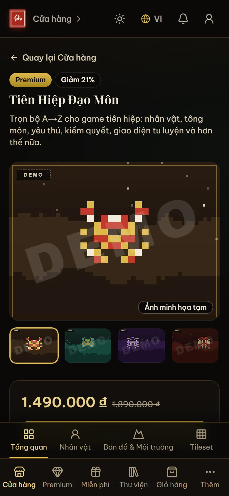 |

### Ba ngôn ngữ

| English                                       | 中文                                            |
| --------------------------------------------- | ----------------------------------------------- |
| 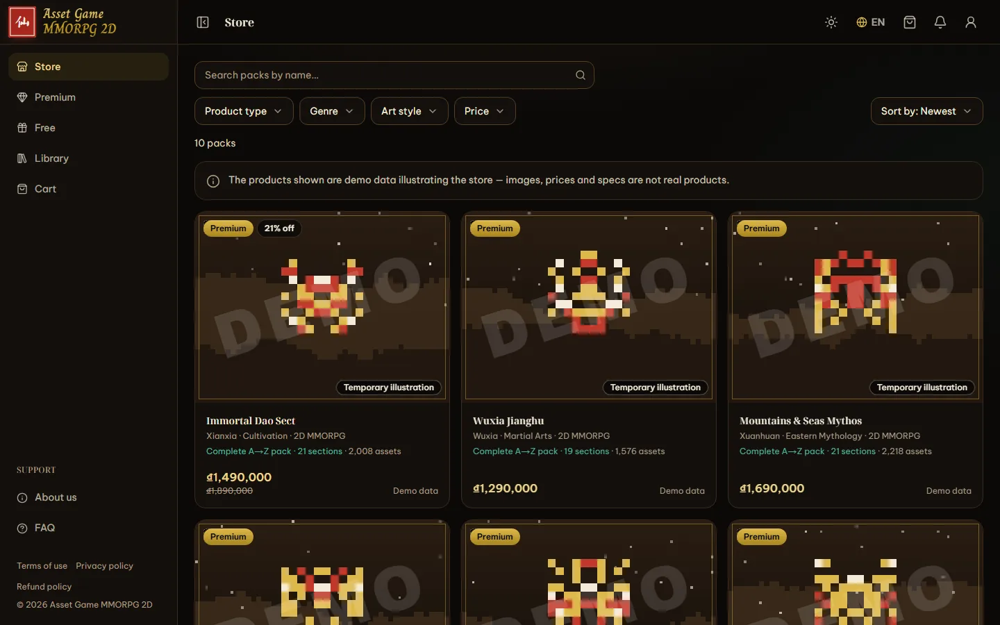 | 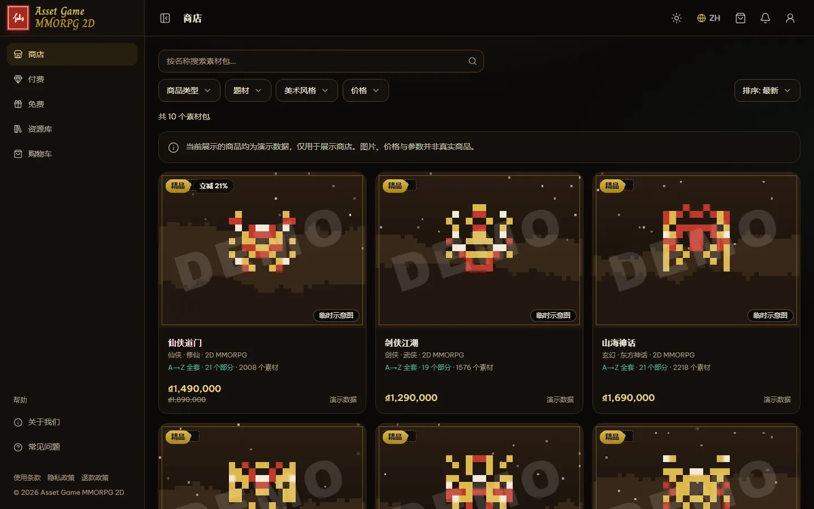 |

### Mua hàng

| Giỏ hàng có mã giảm giá                   | Thanh toán                                      |
| ----------------------------------------- | ----------------------------------------------- |
| 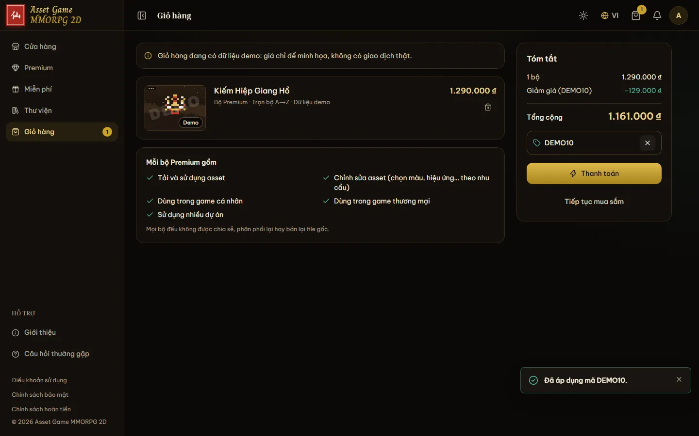 | 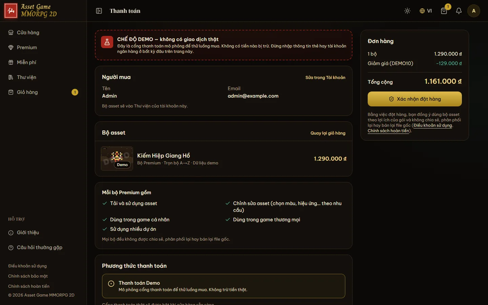 |

| Cổng thanh toán Demo                               | Đơn đã thanh toán                                        |
| -------------------------------------------------- | -------------------------------------------------------- |
| 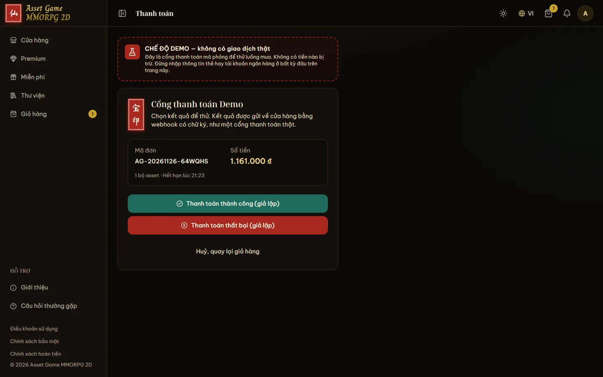 | 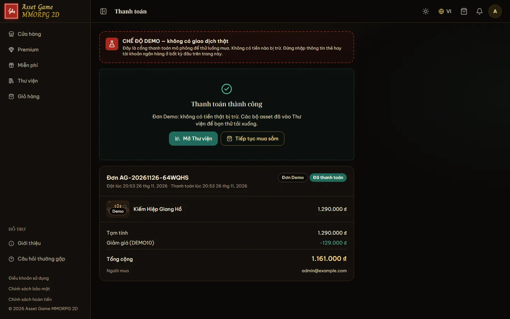 |

| Thư viện cá nhân                             |
| -------------------------------------------- |
| 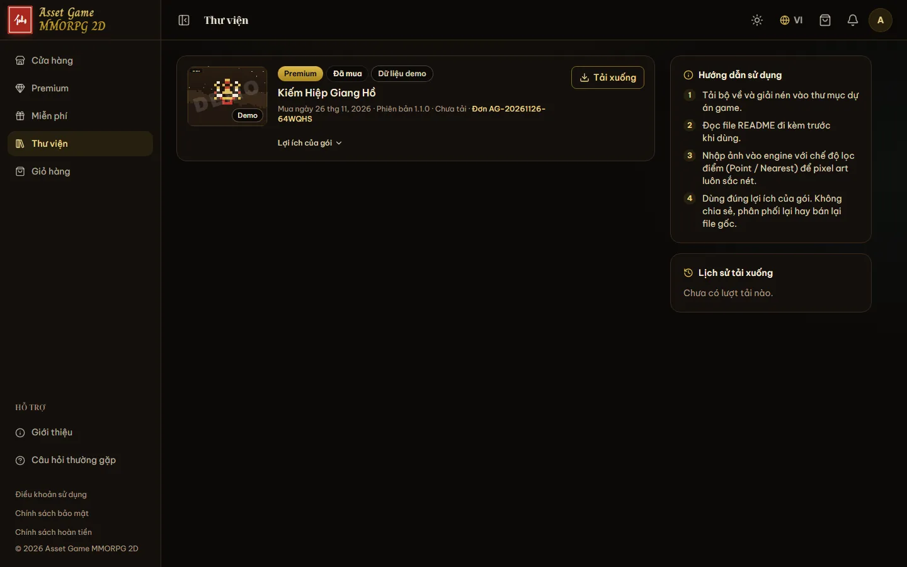 |

### Quản trị

| Tổng quan và biểu đồ doanh thu                       | Trang sửa bộ asset                                          |
| ---------------------------------------------------- | ----------------------------------------------------------- |
| 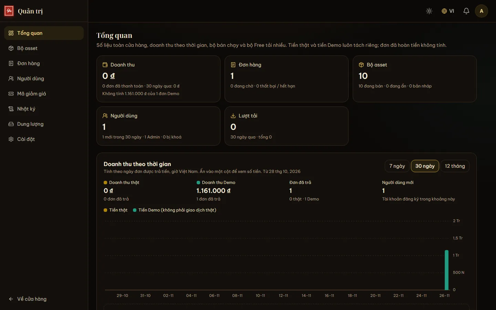 | 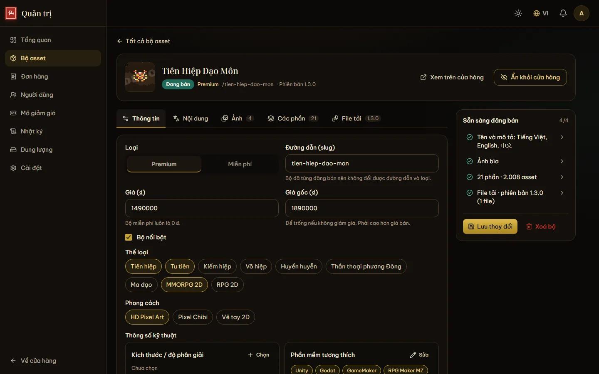 |

| Đơn hàng và tài chính                             | Cài đặt                                            |
| ------------------------------------------------- | -------------------------------------------------- |
| 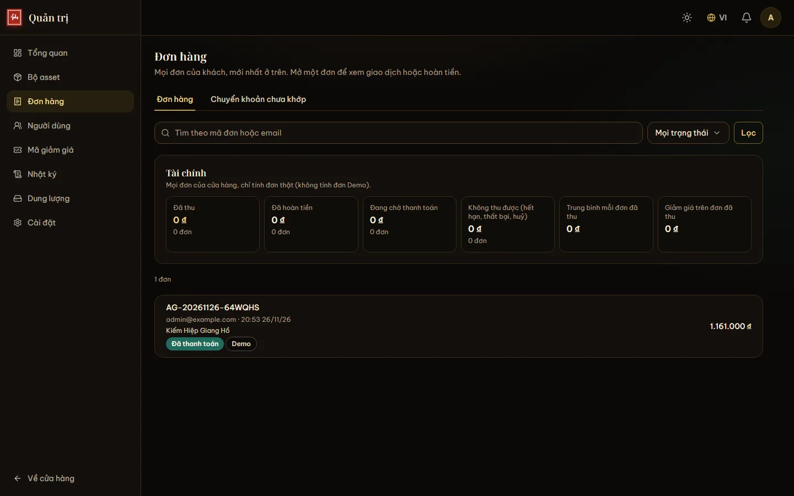 | 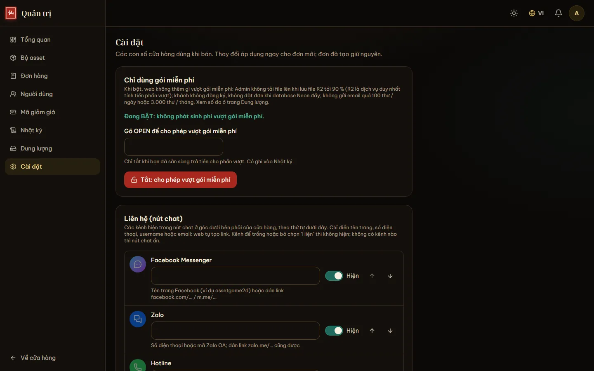 |

## Chức năng

### Cửa hàng

- **Cửa hàng:** tìm theo tên (gõ có dấu hay không dấu đều được); lọc theo loại (Miễn phí / Premium), thể loại, phong cách, khoảng giá; sắp xếp mới nhất, bán chạy, giá tăng hoặc giảm; có phân trang.
- **Trang bộ asset:**
  - thư viện ảnh có trình xem toàn màn hình, ảnh hoặc video xem trước;
  - tổng số asset và các phần (nhân vật, bản đồ, tileset, quái vật, kỹ năng…), có thanh dưới đáy để nhảy tới từng phần;
  - định dạng file, phần mềm tương thích, phiên bản, và ghi chú "Có gì mới" của từng phiên bản.
- **Lợi ích theo gói:** mỗi bộ ghi rõ người mua được làm gì với nó, tách riêng Miễn phí và Premium, thay cho tên giấy phép chung chung.
- **Bộ miễn phí:** hiện chữ FREE và phải đăng nhập mới tải được. Mỗi tài khoản có 2 lượt tải cho mỗi bộ Free và mua thêm được (giá chỉnh ở Admin).
- **Bộ Premium:** nút **Mua ngay** hoặc **Thêm vào giỏ**. Sau khi thanh toán, bộ nằm trong Thư viện, tải không giới hạn.
- **Nút chat liên hệ:** Messenger, Zalo, hotline, Telegram, email, do Admin nhập; mỗi kênh có công tắc bật / tắt. Chưa có kênh nào thì nút ẩn.
- **Trang thông tin:** Giới thiệu, Câu hỏi thường gặp, Điều khoản sử dụng, Chính sách bảo mật, Chính sách hoàn tiền (nội dung mẫu, cần sửa trước khi bán thật).

### Mua hàng và thanh toán

- **Giỏ hàng:** dùng được cho cả khách chưa đăng nhập và đã đăng nhập; giỏ của khách được gộp vào tài khoản khi đăng nhập.
- **Mã giảm giá:** theo % hoặc số tiền, có đơn tối thiểu, ngày hiệu lực, giới hạn lượt dùng.
- **Thanh toán:** giá và tổng tiền luôn được tính lại ở server. Mỗi tài khoản chỉ có một đơn chờ thanh toán; khách chọn thanh toán tiếp hoặc huỷ đơn đó.
- **Cổng thanh toán**, chọn bằng `PAYMENT_PROVIDER`:
  - `demo` (mặc định): cổng giả lập, có băng "Chế độ Demo", không có tiền thật. Bị cấm ở production.
  - `sepay`: chuyển khoản VietQR, đơn được khớp qua webhook SePay có chữ ký.
  - `momo`: ví MoMo. Đã làm và thử trên môi trường thử của MoMo, hiện tạm dừng.
- **Trang Đơn hàng** (trạng thái từng đơn) và **trang kết quả** sau khi thanh toán.

### Thư viện và tải xuống

- **Thư viện:** bộ đã sở hữu, ngày mua, phiên bản, nhãn "Bản mới" kèm ghi chú, lợi ích của gói, hướng dẫn sử dụng, lịch sử tải.
- **Tải xuống:** server kiểm quyền sở hữu rồi mới cấp link, link hết hạn sau 60 giây. File bán không bao giờ nằm trong thư mục hay bucket công khai.
- **Trang Thống kê** cho người mua: số bộ đang có, lượt tải, số tiền đã chi của chính tài khoản đó.

### Tài khoản

- Đăng ký, đăng nhập, đăng xuất, quên mật khẩu (gửi link qua email), đổi mật khẩu, thông tin cá nhân.
- **Tiếp tục với Google** (tuỳ chọn, chỉ hiện khi đã điền khoá):
  - email trùng tài khoản có sẵn thì gộp vào tài khoản đó;
  - tài khoản tạo bằng Google đặt thêm được mật khẩu.
- Đổi mật khẩu hoặc bị khoá tài khoản thì mọi thiết bị khác bị đăng xuất ngay.

### Khu Quản trị (`/admin`)

- **Tổng quan:**
  - doanh thu, đơn hàng, bộ asset, người dùng, lượt tải;
  - biểu đồ doanh thu 7 ngày / 30 ngày / 12 tháng.

  Tiền thật và tiền Demo luôn tách riêng.

- **Bộ asset:**
  - trang sửa dạng thẻ: thông tin, nội dung 3 ngôn ngữ, ảnh, các phần, file tải;
  - danh sách "Sẵn sàng đăng bán";
  - tải file thẳng lên kho lưu trữ;
  - phiên bản kèm ghi chú "Có gì mới";
  - bộ nổi bật, ẩn / hiện.
- **Đơn hàng:**
  - tìm kiếm, lọc trạng thái, bảng tài chính;
  - hoàn tiền (thu lại bộ và lượt tải đã mua thêm);
  - **chuyển khoản chưa khớp** để xử lý tay;
  - tạo đơn tay.
- **Người dùng:** thông tin, lịch sử mua, khoá / mở khoá, tặng bộ.
- **Mã giảm giá**.
- **Nhật ký:** mọi thao tác của Admin.
- **Dung lượng:** đã dùng bao nhiêu trong gói miễn phí của Neon, R2, Resend.
- **Cài đặt:**
  - chế độ **Chỉ dùng gói miễn phí** (mặc định bật): chặn tải file lên, đăng ký, đặt đơn hoặc gửi email trước khi vượt gói miễn phí. Muốn tắt phải gõ `OPEN`;
  - kênh liên hệ của nút chat;
  - giá mua thêm lượt tải Free.

### Ngôn ngữ, giao diện, chất lượng

- **Tiếng Việt (mặc định), English, 中文** cho 100% giao diện, kể cả thông báo, lỗi, trạng thái trống, email và khu Admin. Mỗi bộ asset viết riêng cho từng ngôn ngữ; bộ chưa viết ở ngôn ngữ nào thì ẩn ở ngôn ngữ đó.
- **Phong cách phương Đông:**
  - màu vàng kim, đen mực, đỏ son, xanh ngọc; con dấu đỏ và hoa văn;
  - font thư pháp và font tiêu đề hiển thị đủ dấu tiếng Việt;
  - nền tối mặc định, có nút đổi sang giao diện sáng.
- **Khung dashboard responsive:** menu bên trái trên máy tính, thanh tab dưới đáy trên điện thoại.
- **SEO:** sitemap, `hreflang`, thẻ chia sẻ, `noindex` cho trang riêng tư.

## Điểm đặc biệt

- **File bán không thể bị lộ.**
  - File nằm trong bucket riêng tư; trên máy thì nằm trong `.storage/`, ngoài `public/`.
  - Mỗi lượt tải đều kiểm quyền sở hữu ở server và dùng link ký hạn ngắn.
  - Không bao giờ render URL file Premium vào HTML hay lưu lại.
- **Chỉ thanh toán đã xác thực mới cấp quyền sở hữu.**
  - Bộ chỉ thuộc về người mua khi webhook có chữ ký hợp lệ xác nhận thanh toán.
  - Webhook gửi lại, bị sửa, hoặc sai số tiền đều bị từ chối.
- **Cổng Demo không bao giờ nhận đơn thật:** web từ chối khởi động ở production nếu `PAYMENT_PROVIDER=demo`.
- **Phiên đăng nhập được kiểm với database ở mỗi lần truy cập:**
  - JWT mang `sessionVersion` và được so với giá trị hiện tại của tài khoản;
  - khoá tài khoản hay đổi mật khẩu là phiên cũ mất hiệu lực ngay.
- **Chốt chặn database:**
  - `npm run db:*` từ chối mọi host được khai là production;
  - migration lên production đi qua lệnh riêng và bắt gõ xác nhận mã endpoint.
- **Thiết kế để không tốn tiền:** chế độ "Chỉ dùng gói miễn phí" và trang Dung lượng giữ cửa hàng nằm trong gói miễn phí của Neon, R2, Resend.
- **Giới hạn số lần thử:** áp cho đăng nhập sai, thử mã giảm giá, đăng ký, quên mật khẩu và tải xuống (100 lượt / giờ / tài khoản).
- **Cấu hình được kiểm khi khởi động:** thiếu hoặc sai giá trị thì web dừng và báo rõ biến cần sửa. Ví dụ: dùng Demo ở production, khoá quá ngắn, dùng địa chỉ `r2.dev` ở production.
- **Kiểm thử đầu cuối:**
  - unit test;
  - test tích hợp trên database thật;
  - Playwright trên máy tính và điện thoại cho mọi luồng chính.

## Công nghệ

| Phần         | Công nghệ                                                                                             |
| ------------ | ----------------------------------------------------------------------------------------------------- |
| Ứng dụng     | **Next.js 16.4** (App Router, Cache Components, Turbopack), **React 19**, TypeScript                  |
| Giao diện    | Tailwind CSS 4, Radix UI, icon lucide; font: Be Vietnam Pro, Noto Serif Display, Charm, Ma Shan Zheng |
| Database     | **PostgreSQL** + **Prisma 7** (`@prisma/adapter-pg`); Neon trên cloud, Docker trên máy                |
| Đăng nhập    | **Auth.js v5** (email + mật khẩu băm argon2id, Google tuỳ chọn)                                       |
| Ngôn ngữ     | **next-intl** (`vi`, `en`, `zh`)                                                                      |
| Kiểm dữ liệu | Zod 4                                                                                                 |
| Lưu file     | Thư mục trên máy khi phát triển, **Cloudflare R2** (API S3) khi chạy thật                             |
| Thanh toán   | Demo, SePay (VietQR), MoMo                                                                            |
| Email        | Ghi file vào `.mail-outbox/` khi phát triển, **Resend** khi chạy thật                                 |
| Hosting      | **Vercel** (lịch việc định kỳ trong `vercel.json`)                                                    |
| Kiểm thử     | Vitest (unit, tích hợp), Playwright (E2E, máy tính + điện thoại)                                      |

## Cài đặt nhanh (trên máy, không cần cloud)

### Cần có

- **Node.js 20.9 trở lên** và npm
- **Docker Desktop** (để chạy PostgreSQL), hoặc PostgreSQL bạn đã có sẵn
- Git

### Các bước

Chạy mọi lệnh ở **thư mục gốc** của repo.

```bash
# 1. Lấy code và cài thư viện (tự sinh Prisma client)
git clone <địa chỉ repo của bạn> asset-game
cd asset-game
npm install

# 2. Chạy PostgreSQL bằng Docker (tự đặt mật khẩu)
docker run -d --name asset2d-postgres --restart unless-stopped \
  -e POSTGRES_USER=asset2d -e POSTGRES_PASSWORD=<mật-khẩu-tự-đặt> -e POSTGRES_DB=asset2d \
  -p 127.0.0.1:5432:5432 -v asset2d-pgdata:/var/lib/postgresql/data postgres:17

# 3. Tạo file cấu hình trên máy
cp .env.example .env.local
```

Mở `.env.local`, điền các dòng sau, các dòng khác để nguyên:

```dotenv
DATABASE_URL=postgresql://asset2d:<mật-khẩu>@localhost:5432/asset2d
DIRECT_URL=postgresql://asset2d:<mật-khẩu>@localhost:5432/asset2d
AUTH_SECRET=<kết quả của lệnh: npx auth secret>
CRON_SECRET=<chuỗi ngẫu nhiên từ 32 ký tự (trên máy không bắt buộc)>
```

```bash
# 4. Tạo bảng, rồi nạp dữ liệu demo
npm run db:migrate
npm run db:seed

# 5. Chạy web
npm run dev
```

Mở **http://localhost:3000**. Trang tự chuyển sang `/vi`; đổi ngôn ngữ bằng biểu tượng quả địa cầu.

Trên máy, web chạy như sau:

- Thanh toán dùng cổng **Demo**.
- File lưu ở `.storage/`.
- Email được ghi thành file trong `.mail-outbox/`, không gửi thật.

Bạn có thể gặp cảnh báo `DATABASE_URL` không phải kết nối pooled. Đây là điều bình thường khi dùng database trên máy.

> Trên Windows PowerShell, viết lệnh `docker run` trên một dòng (bỏ dấu `\`).

### Lấy quyền Admin

1. Đăng ký một tài khoản trên web (`/vi/register`).
2. Cấp quyền Admin cho tài khoản đó:
   ```bash
   npm run admin:grant -- ban@example.com
   ```
3. Tải lại trang. Mục **Quản trị** xuất hiện trong menu avatar (`/vi/admin`).

Thu quyền: `npm run admin:revoke -- ban@example.com`. Lệnh này cũng đăng xuất tài khoản đó trên mọi thiết bị.

## Cách sử dụng

### Với người mua

1. Vào **Cửa hàng**, lọc hoặc tìm kiếm, rồi mở một bộ.
2. **Bộ miễn phí:** đăng nhập, bấm **Tải miễn phí**.
3. **Bộ Premium:** bấm **Mua ngay** (hoặc **Thêm vào giỏ**).
4. Ở giỏ hàng, thử một mã giảm giá demo, rồi bấm **Thanh toán** → **Xác nhận đặt hàng**.
5. Ở cổng Demo, chọn **Thanh toán thành công (giả lập)** hoặc **Thanh toán thất bại (giả lập)**.
6. Thành công thì mở **Thư viện** và tải bộ về (bản demo tải về một file README).

Mã giảm giá demo:

| Mã            | Tác dụng                              |
| ------------- | ------------------------------------- |
| `DEMO10`      | Giảm 10 %, không cần đơn tối thiểu    |
| `DEMO200K`    | Giảm 200.000 ₫ cho đơn từ 1.000.000 ₫ |
| `DEMOHETHAN`  | Đã hết hạn (để xem thông báo lỗi)     |
| `DEMOHETLUOT` | Đã hết lượt (để xem thông báo lỗi)    |

### Với chủ cửa hàng

- **Quản trị → Bộ asset:** tạo bộ mới, điền thông tin, nội dung từng ngôn ngữ, ảnh, các phần và file tải, rồi đăng bán khi danh sách kiểm tra đã đủ.
- **Quản trị → Cài đặt:** thêm kênh liên hệ (nút chat sẽ hiện), chỉnh giá mua thêm lượt tải Free.
- **Quản trị → Đơn hàng:** theo dõi thanh toán, hoàn tiền, hoặc tạo đơn tay.
- Xem dữ liệu trực tiếp: `npm run db:studio` (Prisma Studio).

## Cấu hình

Mọi biến được liệt kê và giải thích trong [`.env.example`](.env.example). Giá trị thật **chỉ** nằm trong `.env.local` trên máy bạn. Git đã bỏ qua file này: không commit, không dán giá trị đi đâu.

| Biến                                         | Ý nghĩa                                             | Mặc định trên máy                      |
| -------------------------------------------- | --------------------------------------------------- | -------------------------------------- |
| `APP_ENV`, `APP_URL`                         | Môi trường và địa chỉ web                           | `development`, `http://localhost:3000` |
| `DATABASE_URL`                               | Kết nối app dùng khi chạy (trên Neon là pooled)     | PostgreSQL trên máy                    |
| `DIRECT_URL`                                 | Kết nối trực tiếp, chỉ dùng khi migrate             | trên máy giống dòng trên               |
| `PRODUCTION_DATABASE_HOSTS`                  | Host production mà `db:*` phải từ chối              | trống                                  |
| `AUTH_SECRET`                                | Khoá ký phiên đăng nhập (từ 32 ký tự)               | bắt buộc                               |
| `AUTH_GOOGLE_ID`, `AUTH_GOOGLE_SECRET`       | Đăng nhập Google (điền cả hai hoặc bỏ trống cả hai) | trống = ẩn nút                         |
| `PAYMENT_PROVIDER`                           | `demo`, `sepay` hoặc `momo`                         | `demo`                                 |
| `SEPAY_*`, `MOMO_*`                          | Cấu hình cổng thanh toán                            | trống                                  |
| `STORAGE_DRIVER`                             | `local` hoặc `r2`                                   | `local` (`.storage/`)                  |
| `R2_*`                                       | Bucket và token Cloudflare R2                       | trống                                  |
| `MAIL_DRIVER`, `MAIL_FROM`, `RESEND_API_KEY` | `outbox` (ghi file) hoặc `resend`                   | `outbox` (`.mail-outbox/`)             |
| `CRON_SECRET`                                | Bảo vệ `/api/cron/*` (từ 32 ký tự)                  | trên máy không bắt buộc                |

Web kiểm các giá trị này khi khởi động và từ chối chạy nếu cấu hình không an toàn.

## Dịch vụ tuỳ chọn và chạy thật

Trên máy, dịch vụ nào cũng không bắt buộc. Mỗi dịch vụ có hướng dẫn từng bước trong [docs/OPERATIONS.md](docs/OPERATIONS.md):

| Dịch vụ           | Dùng để                                                                                       | Hướng dẫn          |
| ----------------- | --------------------------------------------------------------------------------------------- | ------------------ |
| **Neon**          | PostgreSQL trên cloud (kết nối pooled + direct, nhánh dev / bản thử / production riêng)       | §2                 |
| **Cloudflare R2** | 2 bucket: ảnh xem trước (công khai) và file bán (riêng tư); kiểm bằng `npm run storage:check` | §7                 |
| **Vercel**        | Bản xem trước (cổng Demo) và web chạy thật                                                    | §8, §9             |
| **SePay**         | Chuyển khoản VietQR, webhook có chữ ký                                                        | `.env.example`, §4 |
| **Resend**        | Gửi email thật (đặt lại mật khẩu); `npm run mail:test -- <email>` gửi một thư mẫu             | §9                 |
| **Google Cloud**  | "Tiếp tục với Google"                                                                         | §10                |

Chạy thật, tóm tắt:

1. Tạo nhánh database production và bucket. Chạy `npm run prod:init`, điền `.env.vercel-production`, rồi kiểm bằng `npm run prod:check`. Lệnh này liệt kê từng giá trị còn thiếu hoặc không an toàn.
2. **Bạn tự** áp migration lên production bằng `npm run db:prod:migrate` (có bước gõ xác nhận). Không bao giờ dùng `db:migrate` hay `db:seed` cho production.
3. Production cần:
   - cổng thanh toán thật (`sepay` chế độ `live`);
   - R2 có tên miền riêng cho ảnh;
   - Resend với tên miền đã xác minh;
   - `CRON_SECRET`.

## Các lệnh

Chạy ở thư mục gốc.

| Nhóm         | Lệnh                                                                    | Việc làm                                                  |
| ------------ | ----------------------------------------------------------------------- | --------------------------------------------------------- |
| Chạy         | `npm run dev`                                                           | Web phát triển tại http://localhost:3000                  |
|              | `npm run build` / `npm start`                                           | Build production / chạy bản build                         |
| Kiểm tra     | `npm run lint` · `npm run typecheck` · `npm run i18n:check`             | ESLint · TypeScript · đủ bản dịch 3 ngôn ngữ              |
|              | `npm run format`                                                        | Prettier                                                  |
| Database     | `npm run db:migrate`                                                    | Áp / tạo migration (chỉ dev)                              |
|              | `npm run db:seed` / `db:seed:coupons`                                   | Dữ liệu demo / chỉ mã giảm giá demo                       |
|              | `npm run db:generate` · `npm run db:studio`                             | Sinh Prisma client · Prisma Studio                        |
| Admin        | `npm run admin:grant -- <email>` / `admin:revoke`                       | Cấp / thu quyền Admin                                     |
| Việc định kỳ | `npm run cron:run` (`-- reconcile` / `-- cleanup`)                      | Đơn quá hạn, dọn giỏ cũ, file mồ côi, bộ đếm              |
| Email        | `npm run mail:preview` · `npm run mail:test -- <email>`                 | Ghi thư mẫu ra file · gửi 1 thư qua Resend                |
| Lưu file     | `npm run storage:check` · `npm run storage:push`                        | Thử R2 từ đầu tới cuối · chép `.storage/` lên R2          |
| Bản thử      | `npm run preview:init` / `setup` / `check` / `grant` / `revoke`         | Bản xem trước trên Vercel                                 |
| Chạy thật    | `npm run prod:init` / `prod:check`                                      | Chuẩn bị và kiểm cấu hình production                      |
|              | `npm run db:prod:status` / `migrate` / `reference` / `grant` / `revoke` | Database production, **chỉ chủ web tự chạy**, có xác nhận |
| Icon         | `npm run icons`                                                         | Tạo lại favicon từ logo                                   |

## Kiểm thử

```bash
npm test                          # unit test (backend + frontend)
npm run test:integration          # test tích hợp trên database dev
npm run build && npm run test:e2e # Playwright, máy tính + điện thoại (build trước)
```

- Trên Windows, chạy Vitest từ **PowerShell**. Chạy từ Git Bash sẽ báo lỗi "failed to find the runner".
- E2E chạy ở cổng 3100 và tự bật server; tắt chương trình khác đang dùng cổng đó trước.
- Test tích hợp và E2E tạo dữ liệu thử có đánh dấu trong database dev rồi tự xoá. Không bao giờ trỏ chúng vào production.

## Cấu trúc thư mục

Một app Next.js chia làm 3 thư mục. Mọi lệnh `npm run …` chạy ở thư mục gốc.

```text
frontend/   App Next.js: trang và route API (src/app), component, style, font,
            bản dịch (messages/vi.json, en.json, zh.json), test E2E
backend/    Code server: module (repository → service → actions), đăng nhập, thanh toán,
            lưu file, email, kiểm cấu hình; schema Prisma, migration, seed; script; test
docs/       Sản phẩm, kiến trúc, giao diện, lộ trình, quyết định, vận hành
```

- Trang chỉ gọi **service**:
  - service chứa quy tắc nghiệp vụ;
  - repository chứa truy vấn Prisma;
  - action / route kiểm đăng nhập và dữ liệu vào.
- Chữ trên giao diện chỉ lấy từ `frontend/messages/*.json`, không viết cứng trong code.

## Lỗi thường gặp

| Triệu chứng                                                  | Cách sửa                                                                                                                                        |
| ------------------------------------------------------------ | ----------------------------------------------------------------------------------------------------------------------------------------------- |
| Web dừng, báo "Cấu hình môi trường không an toàn"            | Đọc danh sách biến bị báo và sửa trong `.env.local`. Đây là chốt chặn có chủ đích.                                                              |
| `db:seed` báo "Invalid URL"                                  | Có biến địa chỉ để trống (ví dụ `MOMO_ENDPOINT=`). Chép lại giá trị từ `.env.example`.                                                          |
| Console báo `JWTSessionError: no matching decryption secret` | Trình duyệt còn cookie đăng nhập ký bằng `AUTH_SECRET` cũ. Xoá cookie `authjs.*` của localhost, hoặc dùng cửa sổ ẩn danh.                       |
| Không kết nối được database                                  | Docker Desktop phải đang chạy; `docker ps` phải có `asset2d-postgres`.                                                                          |
| Không có nút "Tiếp tục với Google"                           | Đúng như thiết kế cho tới khi điền đủ `AUTH_GOOGLE_ID` và `AUTH_GOOGLE_SECRET` (redirect URI `http://localhost:3000/api/auth/callback/google`). |
| Không thấy nút chat                                          | Thêm ít nhất một kênh liên hệ ở Quản trị → Cài đặt.                                                                                             |
| Đã `admin:grant` mà không thấy "Quản trị"                    | Tải lại trang; kiểm email có đúng tài khoản đã đăng ký không.                                                                                   |
| Prisma báo thiếu client                                      | `npm run db:generate` (hoặc `npm install`).                                                                                                     |
| Cổng 3000 bận                                                | Có server khác đang chạy: tắt nó hoặc đổi cổng.                                                                                                 |

## Tài liệu và giấy phép

- [docs/README.md](docs/README.md): mục lục tài liệu.
- [docs/PRODUCT.md](docs/PRODUCT.md): quy tắc kinh doanh, danh mục, dữ liệu demo.
- [docs/ARCHITECTURE.md](docs/ARCHITECTURE.md): kiến trúc hệ thống.
- [docs/DESIGN.md](docs/DESIGN.md): giao diện.
- [docs/OPERATIONS.md](docs/OPERATIONS.md): môi trường và dịch vụ.
- [docs/DECISIONS.md](docs/DECISIONS.md): các quyết định đã xác nhận.
- [CLAUDE.md](CLAUDE.md): quy tắc làm việc cho Claude Code trong repo này.

Repo này chưa chọn giấy phép mã nguồn mở, nên mọi quyền thuộc về chủ sở hữu. Các font đi kèm (Ma Shan Zheng, Noto Serif Display) dùng giấy phép SIL Open Font License 1.1; xem [frontend/src/fonts/README.md](frontend/src/fonts/README.md).
